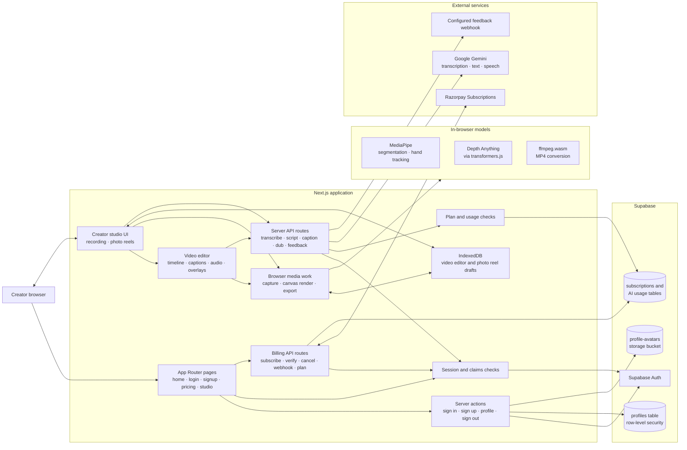
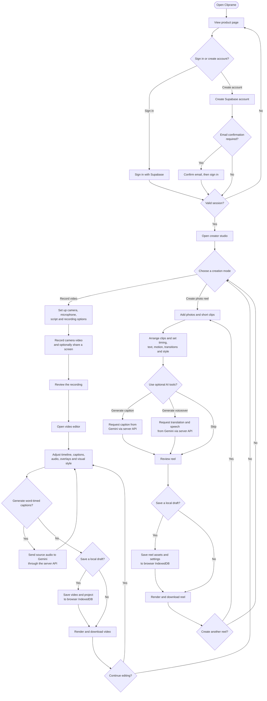
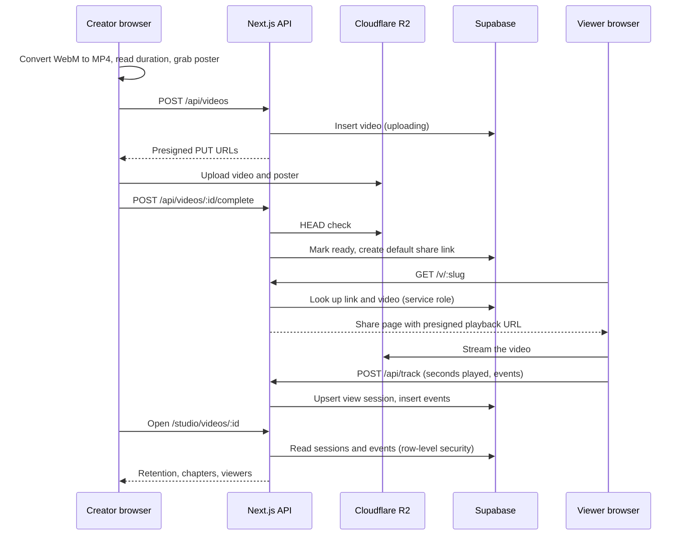
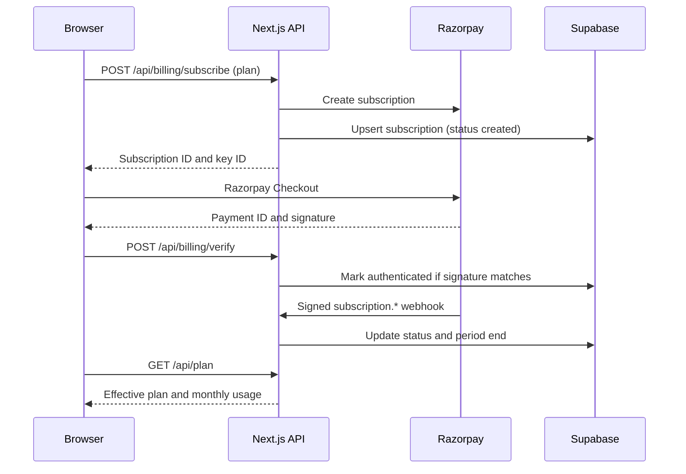

# Cliprame architecture and creator flow

Cliprame is a browser-based creator studio built with Next.js App Router. The diagrams below describe the current implementation; in particular, saved projects are device-local and are not synchronized to user accounts.

## Architecture

### Data and service boundaries

- The Next.js app serves the public pages and the protected studio. Supabase sessions are checked on the server for studio access and AI routes. A separately configured temporary demo session can also unlock the studio.
- Supabase Auth owns user identity. The `profiles` table stores display names and unique usernames, and restricts reads and updates to the authenticated owner with row-level security. Profile pictures live in the `profile-avatars` storage bucket.
- Camera, microphone, and optional display capture happen in the browser. Background segmentation, hand tracking (MediaPipe), depth estimation (Depth Anything via transformers.js), and MP4 conversion (ffmpeg.wasm) also run on the device. Depth maps are cached in IndexedDB.
- Video and photo-reel rendering/export use browser media and canvas APIs.
- Video-editor drafts (including source video and music blobs) and photo-reel drafts (including clip, music, and voiceover blobs) are stored in separate IndexedDB databases on the current browser/device. They are not account-backed or synchronized.
- `/api/transcribe`, `/api/generate-script`, `/api/generate-reel-caption`, and `/api/dub` all call Google Gemini. Provider credentials remain server-side, and these routes require an authenticated Supabase session.
- Usage limits are enforced before each AI call and refunded if the call fails. Transcription and voiceover use monthly minutes that depend on the user's plan (`lib/plans/server.ts`). Script and reel-caption generation use daily request credits (`lib/supabase/ai-quota.ts`).
- `/api/feedback` forwards a rating and comment to the configured webhook. It does not attach video or account data.
- Billing uses Razorpay Subscriptions. The server creates the subscription, verifies the checkout signature, and records status from signed Razorpay webhooks, which are the source of truth for the plan. The `subscriptions` table is written only with the service-role key.
- Plans (`components/pricing/planLimits.ts`): Free (1-minute exports with a watermark), Creator ($15/month: 5-minute exports, no watermark), and Studio ($35/month: 15-minute exports, no watermark). Each plan also sets monthly transcription and voiceover minutes.

## Creator flow

### Sharing a hosted video

### Upgrading a plan

### Optional AI steps

While signed in, the editor can send captured source audio to `/api/transcribe` for word-timed captions. The teleprompter can request a script from `/api/generate-script`; photo reels can request a caption from `/api/generate-reel-caption` or translated speech from `/api/dub`. The server validates each request and calls the configured provider; results return to the browser for review and editing.
